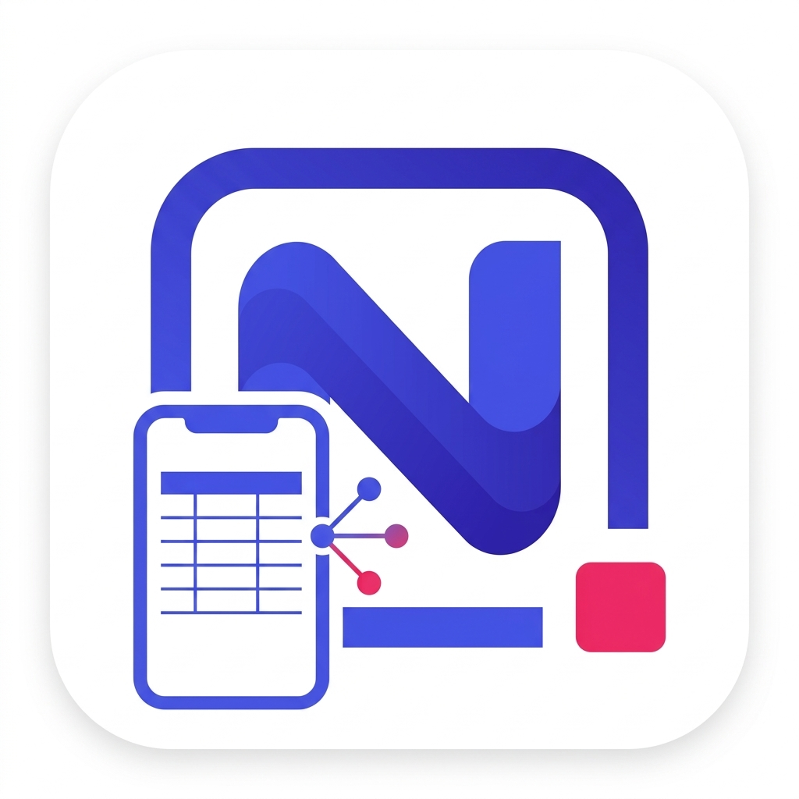

<p align="center">
  
</p>

<h1 align="center">NocoPocket</h1>

<p align="center">
  Mobilny klient <a href="https://nocodb.com">NocoDB</a> na Androida – przeglądaj, dodawaj, edytuj i usuwaj rekordy swoich baz prosto z telefonu.
</p>

<p align="center">
  <a href="https://github.com/M4MU7/NocoPocket/releases/latest"><b>⬇ Pobierz najnowszy APK</b></a>
</p>

---

## Funkcje

- **Bazy i tabele** – lista baz ze wszystkich dostępnych workspace'ów i tabel w każdej bazie.
- **Widok tabeli** – rekordy w formie arkusza przewijanego w poziomie, z zablokowanym nagłówkiem, sortowaniem po kliknięciu w nagłówek kolumny i doczytywaniem kolejnych stron podczas przewijania.
- **Widok Kanban** – rekordy pogrupowane w kolumny według pola typu SingleSelect (np. „Status”), z kolorami opcji z NocoDB. Przełącznik Tabela / Kanban pamięta ostatni wybór.
- **Szczegóły rekordu** – wszystkie pola w czytelnej postaci (kolorowe etykiety wyboru, gwiazdki oceny, daty w czasie lokalnym).
- **Dodawanie i edycja** – formularz dopasowany do typu pola, z walidacją przed wysłaniem. Przy edycji wysyłane są tylko zmienione pola.
- **Usuwanie** – z potwierdzeniem przed usunięciem.
- **Powiązania między tabelami** – pola Links i LinkToAnotherRecord pokazują powiązane rekordy (dotknięcie otwiera rekord z drugiej tabeli). W formularzu możesz dodawać i odłączać powiązania, wybierając rekordy z wyszukiwarką.
- **Jasny i ciemny motyw.**

### Obsługiwane typy pól

| Edytowalne | Tylko do odczytu |
| --- | --- |
| SingleLineText, LongText, Email, URL, PhoneNumber | Lookup, Rollup, Formula |
| Number, Decimal, Currency, Percent, Year | Attachment, User, CreatedBy, LastModifiedBy |
| Rating, Checkbox | CreatedTime, LastModifiedTime, AutoNumber |
| SingleSelect, MultiSelect | Barcode, QrCode, Duration, Geometry |
| Date, DateTime, Time, JSON | |
| Links, LinkToAnotherRecord | |

## Wymagania

- Android 7.0 (API 24) lub nowszy, procesor ARM (`arm64-v8a` lub `armeabi-v7a`).
- Instancja NocoDB z **API v3** (aplikacja powstała pod NocoDB 2026.09.x; self-hosted lub NocoDB Cloud).
- Token API NocoDB.

## Instalacja

1. Pobierz plik `NocoPocket-vX.Y.Z.apk` z zakładki [Releases](https://github.com/M4MU7/NocoPocket/releases/latest).
2. *(Opcjonalnie)* Sprawdź sumę kontrolną SHA-256 podaną w opisie wydania:
   ```bash
   certutil -hashfile NocoPocket-v1.0.0.apk SHA256   # Windows
   sha256sum NocoPocket-v1.0.0.apk                   # Linux / macOS
   ```
3. Otwórz plik na telefonie i zezwól na instalację z tego źródła, gdy Android o to zapyta.

## Konfiguracja

Przy pierwszym uruchomieniu otwórz **⚙️ Ustawienia** i uzupełnij:

| Ustawienie | Opis |
| --- | --- |
| **URL serwera** | Adres Twojej instancji NocoDB, np. `https://nocodb.example.com` |
| **Klucz API (xc-token)** | Token wygenerowany w NocoDB – zobacz [API Tokens](https://docs.nocodb.com/account-settings/api-tokens/) |
| **Workspace ID** | `default` pobiera bazy ze wszystkich dostępnych workspace'ów; możesz też podać konkretne ID |
| **Nazwa pola Status** | Pole SingleSelect, według którego grupowany jest Kanban (domyślnie `Status`). Gdy tabela go nie ma, dostępny jest tylko widok tabeli |
| **Nazwa pola Tytuł** | Pole używane jako tytuł rekordu; gdy go nie ma, używane jest pole główne tabeli |
| **Nazwa pola Opis** | Pole pokazywane pod tytułem na kartach Kanbana |
| **Max. znaków opisu** / **Rekordów na stronę** | Ustawienia wyświetlania |

## Bezpieczeństwo i prywatność

- Aplikacja łączy się **wyłącznie z Twoim serwerem NocoDB** – nie ma analityki ani zewnętrznych usług.
- URL i token są przechowywane lokalnie na telefonie (AsyncStorage, bez dodatkowego szyfrowania). Najlepiej użyj tokena konta z uprawnieniami ograniczonymi do potrzebnych baz.
- Aplikacja pozwala na połączenia HTTP (np. w sieci lokalnej), ale do połączeń przez internet zalecany jest **HTTPS**.

## Ograniczenia

- Pola wyliczane i złożone (Lookup, Rollup, formuły, załączniki, użytkownicy itp.) są tylko do odczytu.
- Daty wpisuje się tekstowo (`RRRR-MM-DD`, `RRRR-MM-DD GG:MM`, `GG:MM`) – z przyciskami „Dziś” / „Teraz”.
- Interfejs jest dostępny tylko po polsku.
- Projekt jest skonfigurowany tylko dla Androida.

## Budowanie ze źródeł

Wymagania: Node.js ≥ 20.19.4, JDK 17 oraz Android SDK (NDK i CMake doinstaluje Gradle).

```bash
npm install
cd android
./gradlew assembleRelease -PreactNativeArchitectures=arm64-v8a,armeabi-v7a
```

Gotowy plik: `android/app/build/outputs/apk/release/app-release.apk`.

## Struktura projektu

```
src/
├── components/   # widok tabeli, Kanban, szczegóły rekordu, formularz
├── context/      # ustawienia zapisywane na urządzeniu
├── hooks/        # pobieranie baz, tabel, schematu i rekordów
├── screens/      # ekrany: bazy, tabele, tabela/Kanban, ustawienia
├── services/     # klient NocoDB REST API v3
├── theme/        # jasny i ciemny motyw
└── utils/        # formatowanie i walidacja wartości wg typu pola
```

## Technologie

[Expo](https://expo.dev) SDK 54 · [React Native](https://reactnative.dev) 0.81 · [React Navigation](https://reactnavigation.org) 7 · [AsyncStorage](https://react-native-async-storage.github.io/async-storage/) · [NocoDB REST API v3](https://nocodb.com/apis/v3/data)

---

<sub>NocoPocket jest niezależnym projektem i nie jest powiązany z NocoDB Inc. „NocoDB” jest znakiem towarowym jego właściciela.</sub>
